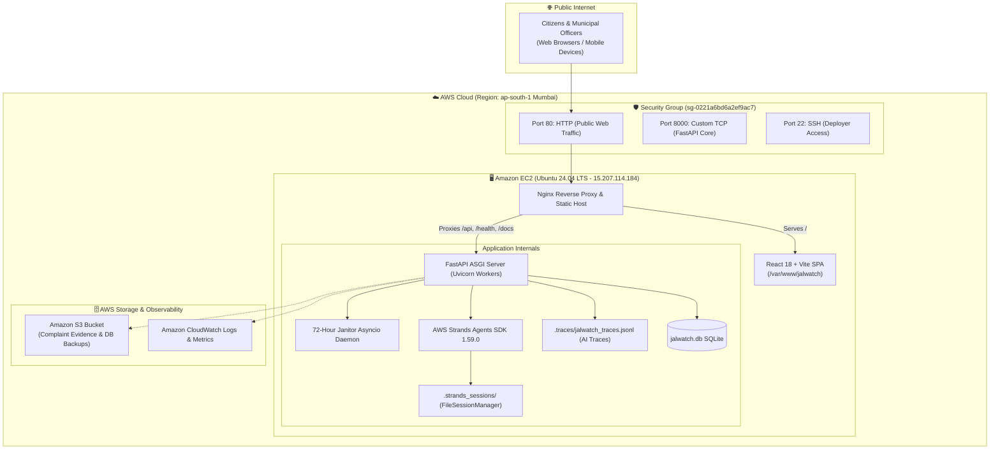

# 🌊 JalWatch Delhi — Citizen-Powered Water Intelligence Platform

[-232F3E?logo=amazon-aws&logoColor=white)](http://15.207.114.184)
[](https://fastapi.tiangolo.com)
[](https://react.dev)
[](https://github.com/strands-agents)
[](https://leafletjs.com)
[](#-testing--quality-assurance)

> **Track 02: Heat and Water**  
> *Transforming scattered citizen water grievances into live geographic intelligence, automated root-cause diagnosis, and rapid municipal dispatch for Delhi Jal Board.*

---

## 🌐 Live Production Links (Judge Quick Access)

| Service | Public URL | Description |
|---|---|---|
| 🖥️ **Live Web App (React UI)** | **[http://15.207.114.184](http://15.207.114.184)** | Full GIS Map, Citizen Grievance Portal & Officer Triage |
| ⚡ **FastAPI Health Check** | **[http://15.207.114.184/health](http://15.207.114.184/health)** | Live ASGI backend system status |
| 📖 **Interactive Swagger Docs** | **[http://15.207.114.184/docs](http://15.207.114.184/docs)** | OpenAPI Specification & Interactive API Explorer |
| 🧠 **AI Observability Traces** | **[http://15.207.114.184/api/admin/traces/stats](http://15.207.114.184/api/admin/traces/stats)** | Real-time multi-agent reasoning metrics |

---

## 🔑 Judge Login Credentials (Admin & Officer Portal)

To test the **Government Operations & Human-in-the-Loop (HITL) Dispatch** features:

1. Open **[http://15.207.114.184](http://15.207.114.184)** in any browser.
2. Click the top-right button: **`🛡️ Officer Portal`**.
3. Enter the configured credentials:
   - **Admin Username:** `admin`
   - **Admin Password:** `admin@jalwatch2026`
4. The **Government Action Drawer** will instantly open with the active hotspot selected, showing the **✍️ Govt Action Form**, **⚡ AWS Strands 5-Point Analysis**, and **📋 Individual Ticket Inspection**!

---

## 📌 Table of Contents
1. [Problem Statement & Solution](#-problem-statement--solution)
2. [End-to-End System Architecture (Flow Diagrams)](#-end-to-end-system-architecture)
3. [Key Features & Innovations](#-key-features--innovations)
4. [Technology Stack & Cloud Infrastructure](#-technology-stack--cloud-infrastructure)
5. [Interactive User Walkthrough (How to Use)](#-interactive-user-walkthrough-how-to-use)
6. [AI Agent Architecture & Observability](#-ai-agent-architecture--observability)
7. [Local Development Quickstart](#-local-development-quickstart)
8. [Testing & Quality Assurance](#-testing--quality-assurance)

---

## 🎯 Problem Statement & Solution

### ❌ The Core Crisis in Delhi
In dense urban regions like West Delhi (Rajouri Garden, Janakpuri, Pitampura, Patel Nagar), municipal authorities receive thousands of isolated grievances daily—muddy water, pipeline bursts, zero pressure, or contaminated supply. Traditional government grievance portals fail because:
- **Siloed Tickets:** Complaints are logged as independent support tickets with zero spatial correlation.
- **Hidden Systemic Failures:** A single trunk pipeline fracture causing 30 dirty water reports across 4 blocks is treated as 30 separate plumbing issues.
- **Zero Citizen Transparency:** Citizens never know when a repair team or emergency water tanker is dispatched, breeding distrust.

### ✅ The JalWatch Solution
JalWatch Delhi transforms passive grievance logging into an **active municipal intelligence engine**:
1. **Real-Time Spatial Hotspot Clustering:** Ingests grievances and clusters them dynamically within a 700m radius threshold.
2. **Autonomous Multi-Agent AI:** Deploys the **AWS Strands Agents SDK** to inspect complaint patterns, determine root causes (e.g., cross-contamination from sewage lines), and recommend triage actions.
3. **Human-in-the-Loop (HITL) Dispatch:** Government engineers review AI synthesis, dispatch mobile repair vans or water tankers, and **broadcast one-click official status alerts to all citizens in the hotspot**.
4. **Automated Janitor Daemon:** Runs a background 72-hour sweep cycle to auto-resolve unverified or stale tickets, ensuring database hygiene.

---

## 🏗️ End-to-End System Architecture

### 1. End-to-End Operational Workflow Diagram
```mermaid
flowchart TD
    subgraph Citizens ["👥 Citizen Layer"]
        C1["Citizen opens JalWatch Web App"] --> C2["Pins exact GPS location on Leaflet Map"]
        C2 --> C3["Submits Grievance (Dirty Water / Leakage)"]
    end

    subgraph BackendEngine ["⚙️ FastAPI Core Engine"]
        C3 --> API["POST /api/complaints"]
        API --> DB[(SQLite / PostgreSQL DB)]
        API --> ClusterEngine["Spatial-Temporal Clustering Engine\n(700m threshold / DBSCAN)"]
        ClusterEngine --> Hotspot["Active Hotspot Cluster Created / Updated"]
    end

    subgraph AIAgents ["🧠 AWS Strands Multi-Agent AI"]
        Hotspot --> AgentA["Agent A: cluster_intelligence_agent\n(Read-Only Database Tools)"]
        AgentA --> Analysis["5-Point Root-Cause Situational Synthesis"]
        Analysis --> AgentB["Agent B: gov_action_assistant\n(Department & Urgency Advisory)"]
        AIAgents --> Tracing["Trace Logger (.traces/jalwatch_traces.jsonl)\n& Optional LangSmith Forwarding"]
    end

    subgraph MunicipalAdmin ["🛡️ Government Operations (HITL)"]
        Analysis --> AdminUI["Admin Operations Dashboard"]
        AdminUI --> OfficerReview{"Municipal Officer\nReviews AI Evidence"}
        OfficerReview -->|Approve & Dispatch| ActionForm["✍️ Record Official Action Form"]
        ActionForm --> ActionAPI["PATCH /api/admin/clusters/{id}/action"]
    end

    subgraph BroadcastLoop ["📢 Citizen Feedback Loop"]
        ActionAPI --> Notify["Broadcast Resolution Update"]
        Notify --> Push["Update all tickets in cluster to 'Action Taken'"]
        Push --> C1
    end

    subgraph JanitorDaemon ["🧹 Automated Background Maintenance"]
        Janitor["72-Hour Janitor Loop (Every 30 Mins)"] --> Sweep["Auto-archive resolved or unverified complaints"]
        Sweep --> DB
    end
```

---

### 2. AWS Cloud Infrastructure Topology


---

## ⚡ Key Features & Innovations

### 1. 🗺️ High-Precision West Delhi Map & Smooth Fly-To
- **Multi-Layer Base Maps:** Real-time toggle between **Streets (OpenStreetMap)**, **Satellite (Esri World Imagery)**, and **Hybrid (Satellite + Road Labels)**.
- **Street-Level Fly-To Navigation:** Clicking any complaint smoothly flies the camera to **zoom level 17**, focusing directly on the problem site.
- **Pulsating Glowing Markers:** Focused complaints animate with a cyan pulse glow (`makeFocusedComplaintPinIcon`) to instantly stand out amidst cluster pins.
- **Floating Problem Inspection HUD:** High-visibility overlay card presenting Ticket ID, Status, Citizen Description, Locality, and GPS Coordinates with quick "Recenter" and "Dismiss" buttons.

### 2. 🧠 AWS Strands Dual-Agent Intelligence
- **Agent A (`cluster_intelligence_agent`):** Formulates a structured 5-point assessment:
  1. *Issue Overview & Volume*
  2. *Geographic Dispersion & Radius*
  3. *Category Frequency Patterns*
  4. *Priority & Triage Level*
  5. *Suggested Actionable Next Steps (Valve inspection, grab sample testing)*
- **Agent B (`gov_action_assistant`):** Advisory assistant that recommends appropriate municipal departments (e.g., *DJB West Maintenance, Tanker Cell*) and urgency categories.
- **Read-Only Database Tools:** Agents are bound to deterministic, read-only Python tools (`get_cluster_details`, `get_locality_breakdown`, `get_dominant_category`), guaranteeing zero hallucinated data mutations.

### 3. ✍️ Human-in-the-Loop (HITL) Dispatch & Citizen Broadcast
- Officers have complete authority over actions.
- **Quick-Fill Templates:** One-click presets for common field actions:
  - 🚒 *Tanker + Van Dispatched*
  - 🔍 *Valve Chamber Inspection*
  - ✅ *Repaired & Resolved*
- **Instant Citizen Broadcast:** Recording an action automatically updates every citizen ticket in the hotspot with an official notification banner (e.g., *"Official Gov Action: Mobile repair van dispatched to valve chamber 4"*).

### 4. 🧹 72-Hour Background Janitor Daemon
- Runs continuously via FastAPI's `lifespan` event loop (every 30 minutes).
- Automatically sweeps and archives tickets older than 72 hours that are marked resolved or remain unverified.
- Exposes manual trigger (`POST /api/admin/janitor/run`) and preview (`GET /api/admin/janitor/preview`) endpoints for administrative audit.

### 5. 🔍 Zero-Dependency AI Observability & Tracing
- Captures every agent thought, tool invocation, and HITL decision to structured JSONL logs (`backend/.traces/jalwatch_traces.jsonl`).
- Admin endpoints (`GET /api/admin/traces` and `GET /api/admin/traces/stats`) provide real-time metrics on token usage, latency, and agent success rates without requiring third-party SaaS accounts.
- Drop-in LangSmith integration supported via environment variables.

---

## 💻 Technology Stack & Cloud Infrastructure

### Frontend Architecture
- **Framework:** React 18 + TypeScript + Vite
- **Mapping & GIS:** Leaflet 1.9 + React-Leaflet
- **Tile Providers:** OpenStreetMap Standard, Esri World Imagery, Esri Reference Boundaries
- **Design System:** Vanilla CSS with HSL Tokens, Glassmorphism, Responsive CSS Grid & Flexbox
- **State & HTTP:** React Hooks (`useState`, `useEffect`, `useCallback`) + Fetch API

### Backend Architecture
- **Framework:** Python 3.11+ / FastAPI (ASGI)
- **Validation & Schemas:** Pydantic v2 Settings & Models
- **Database ORM:** SQLAlchemy with SQLite (local/demo) and RDS PostgreSQL compatibility
- **ASGI Server:** Uvicorn with multi-worker support behind Nginx

### AI & Agentic Stack
- **Agent Framework:** **AWS Strands Agents SDK** (`strands-agents-1.59.0`)
- **LLM Providers:** Groq (`llama-3.3-70b-versatile`) & Google Gemini (`gemini-1.5-flash`)
- **Session Memory:** AWS Strands `FileSessionManager` (persisted per cluster ID)
- **Observability:** Custom JSONL Trace Logger + Optional LangSmith Tracing

### AWS Cloud Infrastructure
- **Compute:** Amazon EC2 (`t3.small`, Ubuntu 24.04 LTS, Region: `ap-south-1` Mumbai)
- **Web Server:** Nginx 1.28 (Reverse Proxy & Static Asset Caching)
- **Storage:** Amazon S3 (Complaint Photos & Automated DB Backups)
- **Security:** AWS IAM Programmatic Access Keys + Boto3 Security Group Ingress Automation
- **Monitoring:** Amazon CloudWatch Logs & Metrics
- **CI/CD:** GitHub Actions with Automated SSH Deployments on `main` push

---

## 🚀 Interactive User Walkthrough (How to Use)

### Scenario A: Citizen Reporting a Grievance
1. Open **[http://15.207.114.184](http://15.207.114.184)**.
2. Click **`+ Report Issue`** on the top navigation bar or the floating water droplet button (`💧`).
3. Select an issue category (e.g. *Dirty Water*, *Low Pressure*, *Pipeline Leakage*).
4. Drag the cyan marker on the West Delhi map to pinpoint the exact leak location (or click anywhere on the map).
5. Type a brief description and click **Submit Grievance**.
6. Receive an instant ticket tracking ID (e.g. `TKT-JAL-9A4B1`) and view real-time status in the **"My Tickets"** tab.

### Scenario B: Municipal Officer Triage & HITL Dispatch
1. Click **`🛡️ Officer Portal`** in the top-right corner.
2. Sign in with `admin` / `admin@jalwatch2026`.
3. The **Government Action Drawer** opens automatically with the active hotspot selected.
4. Review the **Category Breakdown** and **Affected Pockets** (verified database records).
5. Switch to **⚡ AI Analysis** to inspect the AWS Strands 5-point root-cause diagnosis.
6. Under **✍️ Govt Action**, click a quick template (e.g., *🚒 Tanker + Van Dispatched*), assign an engineer, and click **📢 Submit Action & Notify Citizens**.
7. All affected citizens in the hotspot immediately see the updated status banner in their grievance tracking drawer!

---

## 🛠️ Local Development Quickstart

### Prerequisites
- Python 3.10+ (Recommended: Python 3.11)
- Node.js 18+ & npm
- Git

### 1. Clone the Repository
```bash
git clone https://github.com/MeNoodie/JalWatch.git
cd JalWatch
```

### 2. Backend Setup
```bash
cd backend
python -m venv venv

# On Windows PowerShell:
.\venv\Scripts\Activate.ps1
# On macOS / Linux:
source venv/bin/activate

pip install --upgrade pip
pip install -r requirements.txt

# Start FastAPI development server:
uvicorn app.main:app --reload --port 8000
```
- API Docs live at: `http://localhost:8000/docs`
- Health check live at: `http://localhost:8000/health`

### 3. Frontend Setup
In a new terminal window:
```bash
cd frontend
npm install
npm run dev
```
- Web Application live at: `http://localhost:5173`

---

## 🧪 Testing & Quality Assurance

JalWatch includes a comprehensive unit and integration test suite covering the entire API lifecycle, agent tools, session persistence, and janitor sweeps.

Run the test suite:
```bash
cd backend
python -m pytest tests -v
```

### Test Suite Summary (All 18 Passing):
```text
tests/test_admin.py::test_admin_login_success PASSED
tests/test_admin.py::test_admin_login_invalid_password PASSED
tests/test_admin.py::test_admin_clusters_list PASSED
tests/test_admin.py::test_admin_cluster_details_and_complaint_markers PASSED
tests/test_admin.py::test_admin_apply_action_and_notify_citizens PASSED
tests/test_complaints.py::test_create_complaint_and_cluster_mapping PASSED
tests/test_complaints.py::test_cluster_agent_ten_complaints_trigger_and_hitl_notification PASSED
tests/test_janitor_and_traces.py::test_trace_logger_emits_jsonl_record PASSED
tests/test_janitor_and_traces.py::test_observability_traces_endpoint PASSED
tests/test_janitor_and_traces.py::test_observability_stats_endpoint PASSED
tests/test_janitor_and_traces.py::test_janitor_preview_empty PASSED
tests/test_janitor_and_traces.py::test_janitor_sweep_archives_old_resolved_ticket PASSED
tests/test_janitor_and_traces.py::test_janitor_sweep_ignores_fresh_tickets PASSED
tests/test_janitor_and_traces.py::test_admin_janitor_run_endpoint PASSED
tests/test_strands_agents.py::test_strands_provider_metadata PASSED
tests/test_strands_agents.py::test_strands_readonly_tools_and_agent_a PASSED
tests/test_strands_agents.py::test_strands_file_session_manager_context PASSED
tests/test_strands_agents.py::test_strands_agent_b_gov_action_assistant PASSED

============================= 18 passed in 6.10s ==============================
```

---

## 🔒 Security & Privacy Architecture
- **Zero Exposure of Citizen PII:** Citizen reports are keyed to anonymous UUIDs; phone numbers and personal identity are never ingested or shared with AI agents.
- **Deterministic Read-Only Tools:** The AI agent cannot execute arbitrary SQL queries or mutate municipal records—it can only read verified complaints to formulate its situational synthesis.
- **Human-in-the-Loop Safeguards:** AI recommendations are strictly advisory; all field dispatches, status transitions, and public notifications require explicit authentication and authorization from a verified municipal officer.

---

## 👥 Built with Pride
Built solo with passion for the **Delhi Jal Board Municipal Hackathon 2026 (Track 02 — Heat and Water)**, leveraging **AWS Strands Multi-Agent AI** and **Amazon EC2 Cloud Infrastructure**.
