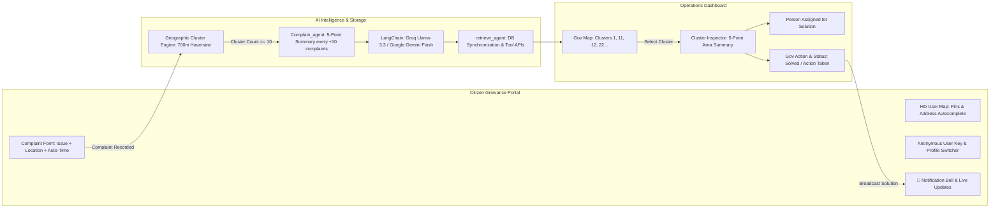

# JalWatch Delhi — Master Architecture & Build Plan

**Project Track:** Track 02 — Heat and Water  
**Working Title:** JalWatch Delhi  
**Core Pitch:** Transform scattered citizen water complaints into live geographic cluster intelligence across Delhi, enabling AI-assisted 5-point root-cause triage and human-in-the-loop government response with instant citizen feedback.  
**Build Strategy:** Local-First Full-Stack Slice (FastAPI + React + Leaflet + SQLite) ➔ LangChain Agent Intelligence (Groq / Google Gemini) ➔ AWS Cloud Target (Amplify + ECS Fargate + RDS PostgreSQL).  
**Last Updated:** 10 October 2026 (Updated with `idea.excalidraw` specifications)

---

## 1. Current Product Goal & Architecture (3-Tier Model)

Based on the validated operational blueprint in `idea.excalidraw`, JalWatch connects citizens, automated AI agents, and municipal engineers in a closed feedback loop:



---

## 2. Core Operational Requirements

### A. User Side (Citizen Experience)
1. **Zero-Barrier Anonymous Tracking:**
   - Persistent citizen tracking key (`usr_xxxxxxxx`) generated via browser `localStorage` on first visit.
   - Profile switcher for seamless local testing (`Rohan Sharma - Rohini`, `Priya Verma - Okhla`, `Amit Kumar - Mayur Vihar`, `Neha Gupta - Karol Bagh`, and `+ New Citizen`).
2. **Interactive High-Definition Delhi Map:**
   - CARTO Voyager HD street tiles with toggle for OpenStreetMap.
   - Real-time address autocomplete search for Delhi colonies, sectors, and streets (Nominatim/Photon).
   - Two-way synchronization: selecting an address moves the pin; clicking/dragging the pin reverse-geocodes into the address field.
3. **Automated Submission:**
   - Automatic live timestamp capture (`datetime.now(timezone.utc)`).
   - Issue category selector (`dirty_water`, `bad_smell`, `no_water`, `low_pressure`, `leakage`, `tanker_needed`, `other`).
   - Instant ticket issuance (`TKT-JAL-XXXX`) mapped with droplet icons.
4. **Citizen Notification Bell `🔔`:**
   - Real-time notification badge alerting citizens when government officials assign field personnel or resolve their cluster.

---

### B. Agent Layer (`Complain_agent` & `retrieve_agent`)
1. **Deterministic Haversine Clustering:**
   - Assigns incoming complaints to the nearest active cluster within **700 meters**.
   - If no cluster exists within 700m, creates a new cluster candidate.
   - Stores every complaint with `cluster_id` in the database.
2. **Every 10-Complaint Trigger (`Complain_agent`):**
   - Whenever complaints in a cluster reach multiples of 10 (`10, 20, 30...`), the AI agent automatically runs.
   - Synthesizes all complaints in that cluster into **5 structured operational points**:
     1. **Most Common Issues:** Dominant water defect & symptom percentage breakdown.
     2. **Spots to Check:** Specific pipeline junctions, valves, or drain crossings in that pocket.
     3. **Quick Action:** Immediate emergency relief (tanker dispatch, low-pressure flushing).
     4. **Root Cause Hypothesis:** Engineering hypothesis (negative pressure suction, supply shutoff back-siphonage).
     5. **Verification Recommendation:** Grab sampling for residual chlorine & turbidity.
3. **Multi-Model LLM Engine:**
   - Powered by **LangChain** with support for:
     - **Groq (`ChatGroq`):** `llama-3.3-70b-versatile` / `llama-3.1-8b-instant`.
     - **Google Gemini (`ChatGoogleGenerativeAI`):** `gemini-1.5-flash` / `gemini-2.5-flash`.
   - **Deterministic Fallback:** Robust rule-based engine activates automatically if LLM API keys are unconfigured, ensuring zero downtime.
4. **Data Retrieval & Sync (`retrieve_agent`):**
   - Persists the 5-point report in `cluster.agent_summary` in the database for the government dashboard.

---

### C. Government Operations Dashboard (`GOVT`)
1. **Master Delhi Cluster Map:**
   - Visualizes all complaint clusters across Delhi (`Cluster 1`, `Cluster 11`, `Cluster 12`, `Cluster 22`...) with color-coded severity.
2. **Cluster Inspector & Evidence Panel:**
   - Displays real-time complaint count, dominant issue, and the **Agent's 5-Point Summary**.
3. **Human-In-The-Loop (HITL) Action:**
   - **Person Assigned for Solution:** Text field / picker to assign field engineers (e.g., *"Er. Ramesh Kumar, Junior Engineer DJB"*).
   - **Official Action & Solution:** Notes describing municipal action (e.g., *"Mobile tanker dispatched to Pocket B; valve chamber leak repaired"*).
   - **Status Toggle:** `Under Investigation` ➔ `Action Assigned` ➔ `Solved / Resolved`.
4. **Citizen Broadcast Engine:**
   - Submitting a government action immediately updates all complaint records associated with that `cluster_id` and triggers the citizen's notification bell `🔔`.

---

### D. AWS Cloud Storage Architecture (Target Phase 7)
1. **Amazon RDS for PostgreSQL:**
   - Stores structured relational data (`complaints` and `clusters` tables).
   - Uses identical SQLAlchemy models as local SQLite (`DATABASE_URL` swap).
   - Deployed in a **Private VPC Subnet** accessible only by the backend container.
2. **Amazon S3 (Simple Storage Service):**
   - Stores citizen evidence photos (e.g., contaminated water tap photos) with pre-signed URLs stored in RDS.
3. **AWS Secrets Manager:**
   - Stores database passwords, Groq API keys, and Google Gemini API keys securely.
4. **Amazon ECS Express Mode (Fargate) & AWS Amplify:**
   - Stateless backend container on ECS Fargate; static React frontend hosted on AWS Amplify.

---

## 3. Technology Stack

| Layer | Choice | Rationale |
|---|---|---|
| **Frontend** | React 18 + Vite + TypeScript | Blazing fast client, typed component contracts |
| **Map Engine** | Leaflet + React-Leaflet + CARTO Voyager HD | Google Maps-quality street detail with zero paid map keys |
| **Geocoding** | Nominatim / Photon API | Live Delhi colony autocomplete & reverse geocoding |
| **Styling** | Vanilla CSS Design System | Responsive dark mode, glassmorphic panels, status pills |
| **Backend** | Python 3.13 + FastAPI + Pydantic v2 | High-performance asynchronous API, auto Swagger docs |
| **ORM / Storage** | SQLAlchemy + SQLite (Local) / RDS PostgreSQL (Cloud) | Shared relational schema across local and cloud |
| **AI / Agent** | LangChain (`ChatGroq` & `ChatGoogleGenerativeAI`) | Dynamic 5-point cluster analysis with fallback |
| **Environment** | `uv` package manager (`JalWatch` venv) | Ultra-fast dependency resolution & virtual environment |
| **Testing** | `pytest` + FastAPI `TestClient` | 100% automated test coverage across health & complaints |

---

## 4. Phase Breakdown & Current Status

```
🟢 Phase 0: Project Bootstrap & Skeleton [COMPLETED]
   ├── FastAPI /health & root endpoints verified
   ├── React + Vite + TypeScript setup
   └── .env.example, .gitignore, README.md

🟢 Phase 1: Citizen Grievance Portal & Core Cluster Workflow [COMPLETED]
   ├── Anonymous citizen persistent tracking (localStorage)
   ├── Multi-user profile switcher bar (Rohan, Priya, Amit, Neha)
   ├── CARTO Voyager HD map with live Delhi address autocomplete
   ├── Two-way geocoding synchronization (address ⇋ pin)
   ├── Memorable ticket generation (TKT-JAL-XXXX)
   ├── 700m Haversine geographic cluster allocation
   ├── 10-complaint agent trigger with 5-point analysis
   ├── LangChain integration with Groq & Google Gemini
   └── Virtual environment `JalWatch` verified with 4/4 pytest pass

🟡 Phase 2 & 3: Government Operations Dashboard & Master Map [IN PROGRESS]
   ├── Master Delhi Operations Map rendering all clusters
   ├── Cluster detail inspection panel with Agent 5 points
   ├── "Person Assigned for Solution" input
   ├── "Gov Action / Solved" submission workflow
   └── Seed script for ~50+ realistic Delhi complaints

⚪ Phase 4: Formal DBSCAN Hotspot Analytics Engine
   ├── scikit-learn DBSCAN with Haversine metric
   └── Time-window velocity analytics (1h / 6h / 24h)

⚪ Phase 5: Citizen Notification Bell 🔔 & Live Feed
   ├── Top header notification bell with unread count
   └── Real-time alert feed when government updates cluster

⚪ Phase 6: Incident Triage & 3-Minute Hackathon Pitch Dry Run
   ├── Full human-in-the-loop rehearsal
   └── Demo reset command

⚪ Phase 7: AWS Cloud Deployment
   ├── Docker containerization
   ├── ECR + ECS Express Mode (Fargate) backend
   ├── AWS Amplify Hosting frontend
   └── Amazon RDS PostgreSQL database in private subnet
```

---

## 5. Definition of Done for Demo

The hackathon pitch is successful when a judge watches this complete 3-minute flow:
1. **Citizen Submission:** User picks an address in Rohini or Okhla using autocomplete, submits a grievance, and receives a ticket code.
2. **Cluster Accumulation:** Nearby demo reports are added; when the count hits 10, the cluster updates on the map.
3. **Agent Synthesis:** The agent automatically outputs the **5 points** (most common issue, spots to check, quick action, root cause hypothesis, verification recommendation).
4. **Government Review & Action:** An officer reviews the cluster, assigns a field engineer, types the solution, and clicks **"Solved"**.
5. **Instant Feedback:** The citizen's **Notification Bell `🔔`** lights up with the official government resolution!
